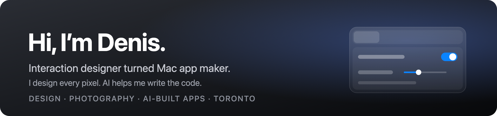
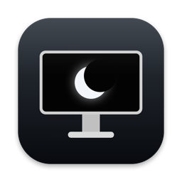
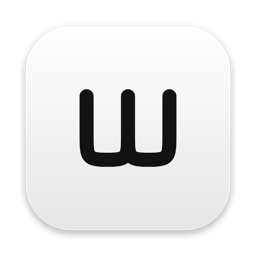

### About me

I'm **Denis Chen**, an independent designer and developer based in **Toronto** 🇨🇦.

- 🎓 I studied **industrial / product design**: physical objects, materials, how things feel in your hand.
- 🧭 I work as an **interaction designer**. Motion, spacing, the 1-pixel details: that's my obsession.
- 📷 I'm also a **photographer**.
- 🤖 Now I build **native Mac apps**, honestly by *vibe coding* with AI (Claude, Codex). I decide what to build and how it should look and behave. AI writes most of the Swift. Then I run it, screen-record it, check it frame by frame, and send it back until it feels right.

I'm not a career software engineer. I'm a designer who finally gets to ship the tools I always wanted.

### What I make

<table>
  <tr>
    <td width="96" valign="top"></td>
    <td valign="top">
      <b><a href="https://github.com/myyccccc/PanelRest">PanelRest</a></b> · macOS · free & open source 
      Turn your Mini-LED / OLED display truly black while your Mac keeps working.
      It wakes only for <i>you</i>, not for AI agents.  
      
      
    </td>
  </tr>
  <tr>
    <td width="96" valign="top"></td>
    <td valign="top">
      <b><a href="https://github.com/myyccccc/Better-Wacom">Better Wacom</a></b> · macOS · open source 
      Custom ExpressKeys and dials for the Wacom Intuos Pro M (2025, PTK-670).
      Per-app layouts, long press, smart dials.  
      
      
    </td>
  </tr>
</table>

More small Mac apps are on the way. ⭐ Star or watch to follow along.

### How I build

- **Native first**: SwiftUI + AppKit, system materials and Liquid Glass. No web views pretending to be apps.
- **Details matter**: concentric corners, consistent spacing, no janky animations. I check every change by recording and reviewing it frame by frame.
- **Private by default**: no tracking, no accounts, no network unless it's needed.
- **For everyone**: each app ships in 8 languages from day one.

<b>中文简介</b>

 

我是 **Denis Chen**，住在**多伦多**的独立设计师、开发者。

- 本科学的是**产品 / 工业设计**；
- 现在是**交互设计师**，也是**摄影师**；
- 最近开始用 AI（Claude、Codex）**vibe coding** 做原生 Mac App：我负责想清楚做什么、长什么样、怎么交互，代码主要交给 AI 写；我再运行、录屏、逐帧检查，直到满意为止。

我不是科班出身的工程师，只是一个终于能把自己想要的工具做出来的设计师。

